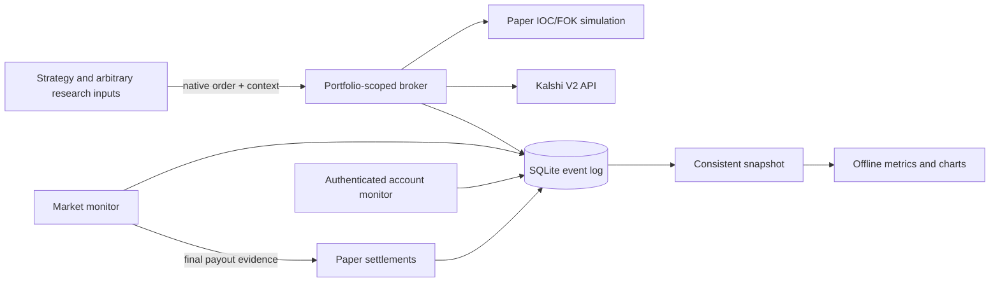

# Broker, portfolios, and independent reporting

The broker records what execution did. Strategies retain their own models,
market readers, schedules, and configuration. Reporting computes portfolio
results from economic facts and independent reference prices.



## Setup and execution

Install packages/czquant and each participating strategy with `uv sync` in its
directory. Strategies declare the shared package as a local dependency.
Export STRATEGY_RUNS_DIR to an absolute directory outside the worktree. Export
credentials explicitly as described in [Kalshi setup](kalshi-setup.md).

From packages/czquant:

```bash
uv run czquant portfolio experiment-a --cash 1000
uv run czquant monitor market
# Separate process, with credentials:
uv run czquant monitor account
```

A portfolio persists across runs. Creation fails if its identifier already
exists. Reopening its broker does not add cash. Each independent paper
portfolio has its own cash and simulated consumed liquidity.

```python
from czquant import Broker, Store
from czquant.kalshi import Kalshi
from czquant.paper import Paper

broker = Broker(Store(), "experiment-a", Paper(Kalshi(authenticated=False)))
broker.start("my-strategy", "git-revision", {"any": "configuration"})
result = broker.submit({
    "ticker": ticker,
    "side": "bid",          # native V2 YES-book direction
    "count": "10.00",
    "price": "0.4200",
    "time_in_force": "immediate_or_cancel",
    "self_trade_prevention_type": "taker_at_cross",
}, context={"experiment": {"hypothesis": "anything"}, "basket_id": "candidate-7"})
```

Orders use Kalshi's V2 bid/ask direction and dollar/count strings. A bid buys
YES or closes NO; an ask buys NO or closes YES. Context is arbitrary JSON and
cannot override order ownership or accounting fields. Large research inputs
should use immutable artifact references. New strategies need no base class.

Intent and context are durable before a submission. Client IDs identify
retries. An uncertain live write retains its reservation and is reconciled by
client ID; a repeated submit does not send another order. Acknowledgement
alone never creates inventory. The account monitor ingests authoritative
fills. Cancel/amend acknowledgements remain distinct from execution.

## Economic record

Every exported event has schema_version, record_id, source_key, sequence,
portfolio_id, run_id, type, effective_at, recorded_at, and data. Timestamps are
canonical UTC. Money and quantities are decimal strings. source_key prevents
duplicate ingestion and rejects conflicting evidence. Local sequence orders
equal timestamps; effective time determines the reporting window and recorded
time determines what evidence was available to a report.

Record types:

- run: strategy name, revision, opaque configuration, and start status.
- order: intent/request/context, acknowledgement, terminal or uncertain state.
- execution: stable fill source, order ID, quantity, YES price, actual fee,
  and venue or paper evidence. One receipt corresponds to one fill.
- transaction: reason, actual cash_delta, optional external_delta and
  prepaid_delta, fee, zero or one inventory leg, order reference, context,
  and evidence. A leg contains market, yes/no side, quantity_delta, and price;
  a settlement can reference its exact opening lot.
- market: market identity, rules and lifecycle metadata, observed depth or
  authoritative payout. Monitors collect held markets and pending orders.
- account_snapshot/account_evidence: private authoritative account responses.
- snapshot: reconstructed paper cash, reservations, and open lots.
- health: component, healthy/degraded/failed state, counts, and errors.
- observation: arbitrary diagnostics. These never determine accounting.
- correction: referenced record IDs and reason. Original facts remain.

The orders and consumed-liquidity tables support execution. The event stream
alone is sufficient for reporting; full execution recovery uses a database
backup that also retains these tables. A correction removes its referenced
facts from accounting replay. Corrections that leave unmatched inventory
retirements fail. Correct related economic records together. Correcting a
paper fill does not automatically restore consumed hypothetical liquidity.

Funding is external capital, not revenue. Fees on buys enter cost basis;
FIFO retirement realizes net proceeds less basis. Rebates/rewards are cash
transactions with their corresponding reason. Collateral cash release uses
an equal negative prepaid_delta so it cannot create profit. Unsupported or
unexplained account effects remain reconciliation gaps, never balancing P&L.

## Paper execution and strategy integration

The shared policy ioc-depth-v1 uses fresh public depth after 300 ms latency,
price limits, available depth, portfolio cash, and quadratic series taker
fees rounded upward to cents. IOC may partially fill; FOK is per order.
Resting/maker orders and unknown fee formulas are explicit unsupported cases.
Their future implementation can use the same order and transaction schema.
Simulated consumption persists through restart. A price level must be absent
for 300 seconds before its consumption is reset. This is a conservative
simulation assumption, not a queue-position or market-impact model.

Sum low/high share classification and sizing code and use versioned JSON
presets. The imported analysis is from Zack's PRs 15 and 16. Unlike their
original atomic paper basket, each leg now executes independently, as agreed.
Context records the intended basket, expected profit/APR, classification,
settlement estimate, reserve pool, and actual per-leg outcomes. Reporting
values actual holdings, including incomplete baskets. A fully settled losing
basket halts the strategy; that halt survives restart. Timed runs propagate
task failures.

From strategies/kalshi_sum_check, after creating the portfolio:

```bash
export CZQUANT_PORTFOLIO=sum-low
uv run python paper_ws.py --preset low --feed rest
```

Use preset high with a different portfolio for the high-APR policy. The
portfolio supplies capital; bankroll flags do not refund an existing account.
The sum strategy's historical dashboard and void tool only read its old
JSONL files. Use the shared report and Broker.correct for new portfolios.

The election strategies opt into the same execution boundary by exporting
CZQUANT_PORTFOLIO. Their existing standalone mode remains for historical
replays and existing loops. The trial enables the shared broker for both.
Their candidate logic is unchanged; shared execution uses the same policy
as the sum strategies. The old strategy-local P&L display is not the shared
portfolio report. Each invocation records a run and scan-complete observation.

## Independent comparison

From packages/czquant:

```bash
uv run czquant report --since 2026-10-24T06:00:00Z \
  --until 2026-10-25T18:00:00Z --output /absolute/path/to/report
uv run czquant export --output /absolute/path/to/events.jsonl
uv run czquant backup --output /absolute/path/to/accounting.sqlite3
```

Reporting snapshots SQLite with its backup API. It requires no credentials,
network, strategy imports, or execution-module imports. It replays prior
history to establish opening holdings. Every portfolio is evaluated on the
same one-minute grid plus funding boundaries. YES midpoint is the average of
the best YES bid and implied YES ask; NO is its complement. Crossed books,
missing two-sided quotes, or books older than 120 seconds are missing marks.
Final confirmed payout values remain valid without a live quote.

Metrics include net P&L (ending equity minus opening equity minus net external
funding), return on opening equity for fixed-capital windows, time-weighted
return across funding boundaries, flow-adjusted sampled maximum drawdown,
realized P&L, change in unrealized P&L, time-weighted cost-basis utilization,
fees, rewards, filled notional, fill count, settled lots, and open lots.
Valuation and monitor health coverage are separate measures. Missing marks
prevent complete-period ranking. Strategy heartbeats/errors provide activity
evidence; they are not profitability measures. The cash reference should
remain at zero P&L. A no-fill strategy has not demonstrated profitable trading.

The output includes metrics.csv, equity.csv, standalone report.html,
comparison.md, the database snapshot, and a manifest with provenance, health,
valuation policy, and snapshot checksum. These artifacts contain private
account evidence and belong in private storage. Only comparison.md is intended
for a public PR comment. Corrections can change a later restatement; retain
both manifests and ingestion cutoffs rather than overwriting an old report.

## Live account boundary

The CLI provides setup, create-subaccount, map-live, and explicit transfer
operations. Mapping requires a flat numbered subaccount without resting
orders and records its opening cash. Transfers require a supplied UUID and
an amount in cents; venue history provides accounting evidence. No daemon
chooses allocations. Never map the same subaccount to two portfolios.

The live adapter follows the current V2 API and has fixture validation, not
real-money execution validation in this rollout. Standard fills, transfers,
and settlements are normalized; settlement amounts and observed cash must
reconcile. Advanced collateral/netting, external manual trading, and existing
inventory bootstrap need additional authoritative normalization before their
results can be ranked. Preserve raw evidence and report discrepancies. This
limitation is in the normalizer, not a restriction on broker context or the
strategy interface. Do not infer live readiness from paper success.
