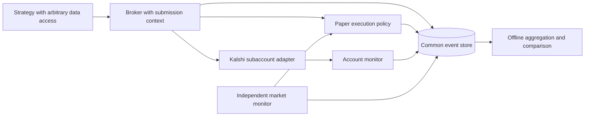

# Strategy broker and independent reporting implementation plan

Status: proposed implementation, written 2026-10-24. No broker implementation,
new experiment processes, report timer, or implementation PR exists from
this plan yet. The work is an MVP for common execution accounting and a
refinement of the comparison metric, not an optimization of strategy returns.

## Goal and completion criteria

Any strategy can trade through a broker and attach arbitrary diagnostic
context. The same economic record supports comparison without importing
strategy code. Strategies control their own data access, scheduling, models,
and configuration. Portfolio state persists independently of process runs.

Completion means a review-ready PR with passing CI; broker-backed paper runs
of both sum configurations; independent market and account monitors; a
reproducible report command; and a verified one-shot report timer for Sunday,
2026-10-25. The proposed cutoff is 18:00 UTC and report generation is 18:05
UTC. The timer is to be installed during implementation, not by this document.

The trial uses hypothetical funds. No real allocation amount has been
specified. Advanced API activation is authorized when credentials and venue
prerequisites are available; this does not authorize a qualifying trade or
real-money funding as part of setup.

## Source and integration base

Start implementation from a fresh worktree of origin/main. The planning
snapshot is main 25521e2. The source sum implementations are
[PR 15](https://github.com/Zack-Ellington/cz-quant/pull/15), revision d5e763b,
and [PR 16](https://github.com/Zack-Ellington/cz-quant/pull/16), revision 7c73f94.
Re-fetch before implementation and account for any changes since this snapshot.

Both PRs add the same strategy directory. Import their common implementation
once and preserve the two configurations as named presets. Record attribution
to both PRs in the implementation PR. Do not merge either PR automatically or
pretend they are two independent directories that can both be copied unchanged.

## Design decisions

1. No funding-manager service. Kalshi subaccounts isolate live portfolios.
   A small operator CLI creates/maps subaccounts and performs explicit,
   identified transfers. The ledger records funding. The live broker uses
   venue balances and manages in-flight order reservations. Paper portfolios
   need their own cash and reservation accounting because Kalshi does not
   contain their transactions.
2. A portfolio is cash, inventory, reservations, and history. Strategy identity,
   code revision, and opaque configuration belong to run records. Reopening a
   portfolio does not initialize funding again. Fresh comparisons use fresh
   portfolios; rolling deployments retain inherited positions and ownership.
3. Broker operations follow exchange actions: submit, batch submit, amend,
   cancel, read state, and attach observations. There is no strategy base class,
   mandatory data reader, or shared research scheduler. Context cannot override
   accounting fields or select a different portfolio.
4. Persist JSON-compatible context before submission, linking it to the client
   order ID and every resulting fill. Preserve nested data without imposing
   strategy-specific fields. Large inputs use immutable artifact references.
   Context is diagnostic, not an input to the report's P&L calculation.
5. Preserve sum-strategy execution assumptions explicitly. Its current paper
   model fills all legs together after a recheck. Keep this as a named,
   versioned paper execution policy with one accounting record per leg. Batch
   submission does not imply atomic live execution. Do not silently change
   the sum analysis by replacing its basket fill with sequential fills.
6. Keep both sum presets as written. The low preset has max APR 20, reserve
   fraction 0.30, and reserve minimum APR 1. The high preset has min APR
   20.0001, reserve fraction 0.50, and reserve minimum APR 100. Other strategy
   parameters remain at their source defaults. This compares two complete
   policies, not the causal effect of APR alone. Do not tune after seeing the
   Sunday results.
7. Keep accounting and valuation independent. Strategies can use their own
   market data. Monitors record reporting references; execution adapters
   preserve the particular observations used for simulated fills.
8. Use one local SQLite event store with transactional reservations and unique
   source keys. Accounting events are append-only. State projections are
   rebuildable. Reporting reads a consistent snapshot without execution imports
   or credentials. Retain an export in the common JSONL schema.

## Shared package and command surface

Add packages/czquant as a uv project, installed by participating strategies
through explicit local dependencies. Keep their separate environments.
Proposed modules are schema, store, broker, paper, kalshi, monitor, and report.
This is a small package, not a plugin framework or collection of services.

Expose a flat czquant CLI with setup, portfolio, monitor, report, and export
operations. The exact flags are part of implementation. Existing strategy CLIs
stay independent. No proposed CLI example in this document is an available
command until implementation adds and tests it.

Setup checks API limits, optionally performs the authorized Advanced upgrade,
then verifies the tier. Portfolio operations create paper capital or map an
explicitly created live subaccount. Live transfer commands require an explicit
amount and retain a stable client transfer ID. Setup never funds or trades.

## Work packages and acceptance checks

### 1. Freeze the economic contract

Implement versioned record types for run metadata, transactions, market data,
account snapshots, corrections, and observations. Use UTC effective and
recorded timestamps, decimal strings, stable record/source identifiers,
portfolio/run ownership, and references to original evidence. Include the
exchange/shard identity when needed to make venue identifiers unique.

Transactions must represent buys, sells, partial fills, fees, rebates,
external funding, netting/collateral adjustments, and nonbinary settlement
payouts. Record quantities and actual cash effects. An order acknowledgement
does not change filled inventory. A correction does not erase the original.

Verify: small hand-computed round trips reproduce cash, inventory, fees, and
equity exactly; collateral return does not create profit; insufficient or
unknown accounting evidence marks a reconciliation gap instead of creating
an unexplained balancing transaction.

### 2. Broker, identity, and execution adapters

Persist intent, context, ownership, and reservation before sending an order.
Ingest execution evidence once even if received through acknowledgement,
WebSocket, and REST recovery. Normalize all paths to the same source identity.
Handle uncertain submission status by recovery with the existing client ID.
Do not blindly generate another order on timeout.

Build paper execution and live Kalshi adapters behind the same operation
surface. Paper execution uses explicit latency, fees, depth, consumed-liquidity,
and fill-policy versions. Reservations and fills are atomic within a portfolio.
Independent paper portfolios do not consume each other's hypothetical cash or
liquidity. Brokers scoped to one portfolio do share its reservations.

Verify: concurrent orders cannot overspend; rejected/canceled unfilled orders
release only appropriate reservations; partial fills and later cancels agree;
restart neither replenishes funding nor refills consumed liquidity; nested
context survives unchanged through every execution path. Test live writes
with fixtures or a test environment, not real-money orders.

### 3. Market and account monitors

Implement a monitor command whose independent tasks cover public market
references, paper accounts, and authenticated live account observation. It
runs outside strategy processes and remains active after they stop.

The market task derives required markets from held inventory and outstanding
orders, plus optional watchlists. Save depth snapshots every minute and on
funding/report boundaries, contract rules/version references, lifecycle changes,
and final payouts. Mark books invalid after sequence gaps until resynchronized.
Distinguish a quiet but synchronized book from a disconnected data source.

The paper-account task applies final settlements, corrections, and snapshots
without needing the strategy loop. The live account task collects orders,
fills, settlements, funding, and account snapshots; recovers paginated history
using overlap and historical cutoffs; and reconciles reconstructed state with
venue observations. Never count paper transactions as real account evidence.

Keep health and failure records for each task. Run the supervisors independently
of this chat session. Public REST polling is an acceptable paper-data fallback;
authenticated account observation has no credential-free substitute.

Verify: stop a strategy, change a fixture market to settled, and see settlement
and valuation continue; disconnect/reconnect feeds without duplicate fills;
fail one task and observe a nonhealthy service rather than a successful-looking
timed run. Verify actual read-only account access before claiming the live
account monitor is operational.

### 4. Integrate strategies without changing their analyses

Port the common sum implementation from the two source PRs. Replace its private
accounting and ledger writes with broker operations. Preserve classification,
pricing, sizing, approvals, and the named paper fill assumptions. Persist the
loss-triggered halt across restart and propagate task failures, addressing the
faults reproduced in the initial review.

Attach candidate class, expected edge/APR, settle estimate, rule references,
reserve pool, and decision snapshots as context. Keep these out of realized
P&L. Consolidate the duplicated presets into explicit configuration files.

Adapt the two existing election strategies at their execution boundaries so
the initial comparison also exercises different strategy logic. Preserve each
existing execution policy with a clear label where it differs. Keep legacy
data as historical evidence; do not invent missing marks or funding to make
old ledgers comparable with new portfolios.

Verify: replay the source strategies against identical fixtures. Candidate
decisions and intended fills agree before and after migration, apart from
documented correctness fixes. All four configurations write the same economic
schema. Existing strategy tests and the new broker tests pass.

### 5. Independent reporting

Create the report implementation before the trial. Replay all prior events
to establish opening inventory at the common start; include open positions at
the cutoff. Separate effective time from the report's recorded-data cutoff.

Use the same midpoint valuation policy for every portfolio, a one-minute grid,
and a maximum observation age of 120 seconds for polling snapshots. A valid
streamed book remains current while synchronized even if prices do not change.
Use confirmed payout values for finalized claims awaiting cash settlement.
Missing coverage makes the affected valuation incomplete, not zero. Preserve
open-position mark age, source, and valuation policy version.

Report net P&L, return on total allocated equity, sampled maximum drawdown,
realized P&L and the change in unrealized P&L under one documented cost-basis
policy, time-weighted capital utilization, fees/rewards, filled notional,
activity, and valuation/monitor coverage. Include an all-cash reference.
Label paper execution policies. Expected profit/APR remains diagnostic.
Incomplete portfolios do not receive a complete-period ranking.

Return is P&L / opening equity for the fixed-funding trial. Preserve funding
events and support time-weighted return for later windows with cash flows.
Drawdown uses the flow-adjusted curve. Show realized gains as a decomposition,
not a substitute for valuing positions that remain open.

Verify: replay after disconnect, duplicate ingestion, restart, and correction
gives the expected result; holding across the window is accounted for; a
no-trade portfolio appears at zero with valid coverage; reporting works with
no strategy package installed and no network or credentials.

### 6. Storage, setup, and operation

Use STRATEGY_RUNS_DIR as the shared state-root contract, outside worktrees.
Place the SQLite store, market artifacts, service logs, and report outputs
there. Store code, schemas, small configs, and report manifests in Git.

Follow the workspace data-storage convention: archive market data and
consistent database backups in a private GCS location with manifests and
checksums. Use SQLite's backup API; do not rsync an open database/WAL pair.
Keep raw live account evidence private. Test restore and offline reporting
from the archive. Record any missing bucket configuration as an operational
blocker rather than claiming backup succeeded.

Update README, strategy/template examples, environment examples, setup
instructions, and recovery commands together. No implicit .env loading.
Document Advanced access as a requirement for live subaccounts only.

Install service supervision with restart behavior and durable health logs.
Record exact code revision, commands, portfolio IDs, data path, service names,
and restore instructions in a small trial manifest. Do not disturb older
paper loops or remove their worktrees as part of this rollout.

Verify: fresh uv installs, zero basedpyright errors for changed Python
projects, meaningful tests, a crash/restart exercise, archive restore, and a
fresh-shell reproduction of report generation.

### 7. PR and sustained paper trial

Open one implementation PR against current main, credit both source PRs,
explain the shared contract, and attach validation results and a small example
report. Drive CI to green. Do not merge automatically. Run from the tested PR
revision in a persistent worktree; a merge is not required for the paper trial.

Start the monitors first. Verify public data and authenticated account access.
Create clean paper portfolios with $1,000 each for sum-low, sum-high, independent
election, and dependence election, plus an all-cash reference. No mid-trial
funding changes. Use identical model versions across the sum variants.

After warm-up and successful recovery checks, record one common UTC start T0
and enable strategy execution. Do not reuse preliminary smoke-test fills in
the clean trial. Confirm independent process health and ledger growth after
launch; a PID alone is not evidence of operation. Actual opportunities are not
guaranteed, so no minimum fill count is a launch requirement.

If authenticated account access remains unavailable, paper execution can be
tested, but the requested full rollout is explicitly incomplete. Do not label
paper state snapshots as live account validation.

### 8. Sunday comparison

Proposed schedule: cutoff Sunday 2026-10-25 at 18:00 UTC; aggregation at 18:05
UTC. Install a persistent, one-shot scheduler entry only after the report
command and trial manifest exist. Verify the installed timer and test the
same command immediately with a temporary cutoff. A written plan or chat
reminder is not a scheduled computation.

At cutoff, preserve a consistent data snapshot. The report uses effective
events through 18:00 and an explicit ingestion cutoff, allowing the short
collection delay without including later trading. Emit HTML charts, CSV
metrics and equity curves, a concise comparison, and a provenance manifest.
Save private source evidence separately from any public PR artifacts. Append
the non-sensitive comparison and artifact references to the implementation PR.

The report includes the exact exposure duration, coverage, execution-policy
differences, open holdings, settlement counts, and corrections. Compare the
two sum policies as complete configurations. A short trial or zero settlements
cannot establish long-run profitability. A zero-trade result is still a valid
observed result when monitoring and evaluation were functioning.

If no verified trial begins before the cutoff, produce a readiness/missing-data
report at the planned time instead. Do not fabricate a trial start or move the
window silently. Continue monitors for remaining positions after the report;
the reporting cutoff does not liquidate them or imply settlement.

## Current dependencies

At planning time, no Kalshi credential variables were exported and no .env
files were found under the cz-quant project directory. A credential location
has been requested, without requesting secret values in chat. This blocks
the authorized account upgrade and actual live-account monitoring, but not
the schema work, tests, reporting implementation, or public-data paper tests.

The upgrade also has an API-order-history prerequisite, documented in
[Kalshi setup](kalshi-setup.md). If unmet, surface it without submitting an
order to manufacture eligibility. API setup changes are separate from funding
or running live strategies.

No implementation PR has been opened, no new sustained trial has been
launched, and no Sunday timer has been installed by this planning change.
