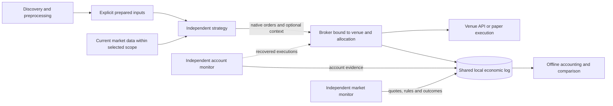

# Design principles: independent strategies, uniform accounting

This is the authoritative design reference for CZ Quant. It governs new
development, reviews, and refactors. It defines the intended boundaries;
existing code is not evidence that an exception is part of the contract.
The [service guides](../README.md#shared-services) describe available
implementations and commands. This document owns the shared interface and
economic schema; service guides describe how to use them.

Terms such as venue, account, cash pool and portfolio are summarized in the
[glossary](glossary.md); this document remains authoritative.

## Purpose

CZ Quant exists to try, replace, and discard many trading strategies. Most
experiments will not succeed. The codebase must make the next experiment
cheap, including when it requires a complete rewrite. Copying code is welcome
when it lets experiments evolve independently.

We also need to compare and aggregate their results fairly. This creates a
tension: common interfaces make measurement easier, but each interface limits
what a strategy can try. Resolve that tension with a small execution boundary
and a common economic record. Keep research choices inside each strategy.

## Core principles

1. Optimize for experimentation. Rewrites and duplication are valid design
   choices. Do not preserve an abstraction merely because several strategies
   currently resemble one another. The recorded code revision, run configuration
   and prepared inputs should be enough to reproduce a run. Variants are
   separate strategy copies or separate runs with distinct revisions and
   configurations.
2. Measure strategies consistently. Record actual or simulated executions,
   capital flows, and positions in a common format. Apply the same reporting
   policy to the portfolios being compared, with differences in execution
   assumptions and evidence coverage made explicit. Comparability comes from
   the broker's economic record, not from shared strategy configuration;
   configuration is recorded opaquely for provenance.
3. Keep every strategy independent. A strategy owns its research choices, models,
   market readers, sizing, execution sequence, configuration, dependencies,
   and schedule. It must be possible to change or retire it without changing
   another strategy. Do not import from another strategy, subclass its engine,
   or require a shared strategy framework. Copy useful code into the experiment
   that needs it. Common research utilities are not part of the required
   interface; prefer local copies when shared changes would couple experiments.
4. Make uniform trade logging the minimal integration requirement. A thin
   broker wraps one venue's execution API and records what was requested and
   what happened locally. Paper execution simulates live execution using the
   same venue ownership,
   capital constraints, reservations, and economic accounting. Only the
   execution/evidence source differs, with simulation assumptions identified.
5. Bind each broker to one venue and an explicitly selected cash pool. Every
   strategy must make every trade through a broker, including exits, repairs, and retries. Use a broker for each venue
   and allocation being traded. Shared accounts and allocation management belong
   in broker infrastructure and must preserve ownership of every cash and
   position change. The broker is authoritative for venue ownership, allocation
   scope, reservations and available cash. Strategies use these checks through
   the broker instead of copying its execution constraints. Preflight and
   submission use the same rules; preflight does not reserve funds or guarantee
   execution. Strategies retain sizing and coordination across legs.
   Pools may be sized unevenly; see
   [fair comparison](#storage-and-fair-comparison) for how totals combine them.
6. Keep reporting observation independent of strategy decisions. Account and
   market monitors collect references for accounting and comparison. Strategies
   may read markets directly and need not call monitors, read their storage, or
   consume their health records. A strategy may choose to use monitor outputs;
   that choice does not become a requirement for other strategies.
7. Keep reporting outside strategies. Performance reports, dashboards, and
   valuation belong in independent reporting services that read the shared
   ledger and recorded reference data. Strategies emit economic facts through
   their brokers and may attach diagnostics or arbitrary context; they do not
   maintain a second P&L ledger or implement reporting views. Reporting must
   not import strategy code or require the strategy process to remain running.
8. Separate preprocessing from execution. Discovery, matching, aliases and
   reviewed overrides produce explicit inputs before a run starts. These tools
   can evolve independently of the execution loop. Record their resolved output
   or an immutable artifact reference with the run. Current market reads inform
   execution within the selected scope; they do not silently expand that scope.
9. Prefer explicit contracts and simple runtimes. Keep one authoritative source
   for each configuration choice. Validate external inputs at their boundaries;
   remove duplicate checks, silent fallbacks and obsolete configuration adapters.
   Retain checks needed for ownership, changing execution state and uncertain
   outcomes. Historical economic records remain readable and auditable; handle
   their compatibility or migration separately from runtime configuration.

The broker is the only mandatory strategy integration surface. Installing it
may install accounting and venue dependencies internally. That does not impose
their APIs, SQL tables, or a common market reader on strategy authors. Separate
strategy installations and pinned dependencies should preserve each
experiment's ability to evolve independently. The repository's template is a
starting point, not a required runtime architecture.

## Broker boundary and cash ownership

Here, venue means an execution service such as Kalshi or Polymarket US. It
does not mean one event or contract within that service. One broker may trade
many contracts at its venue, but it does not route between venues.

An account holds cash and positions at a venue. A cash pool is a persistent
allocation of that account's cash and positions, with one venue and one mode.
Several pools may share a real account, but their allocations cannot count the
same cash twice. A broker binds to exactly one pool; its state and available
cash exclude every other pool, including other pools at the same venue.

A strategy operates on an explicitly selected portfolio of funded cash pools
through their brokers. Portfolio and run lifetimes are independent. Creating or
funding pools is an explicit allocation operation outside strategy startup.
Starting a run or changing its configuration does not fund pools or reset their
history. Pools are not permanently bound to a strategy, experiment ID or market
pair. A later run may reuse them when their holdings, orders and allocation scope
are compatible; otherwise reconcile the existing state before changing use.

A reporting portfolio is a flat selection of cash pools. It owns no additional cash,
executes no orders, and does not make its pools' balances interchangeable.
For example, a cross-market experiment uses two venue pools and two brokers;
a reporting portfolio can combine their performance. A strategy need not
create or know about this reporting selection.

Pool identity persists across runs. Reopening a broker does not fund its pool
again, erase losses, or discard outstanding orders and positions. A run records
which strategy revision used the pools. Fresh experiments use explicitly
funded new pools; a new run or reporting portfolio alone does not isolate cash.

Paper pools can be funded with any explicit nonnegative hypothetical amount,
including large balances. They remain venue-specific. Paper and live use the
same broker budget checks, reservations, ownership and accounting; the adapter
supplies simulated or actual venue results. Total cash across pools is not
buying power at an individual venue. A pool cannot borrow from another pool
implicitly. Cross-venue transfers need an explicit supported mechanism and
recorded completion, including simulated timing when supported in paper mode.

A strategy may use as many broker instances as its experiment needs. For
example, a strategy trading two venues uses two brokers that write to the
same logging directory. Optional context can link their orders for analysis.
Data a strategy uses to decide, including historical data, is selected and
owned by that strategy; market monitors supply reference data for reporting
only. The strategy controls order sequencing and partial-fill handling. A common
trade identifier does not promise atomic execution across venues.

For example, the [cross-market strategy](../strategies/cross-market-polymarket/)
considers exactly one prepared market pair per run. Independent experiments on
other pairs run in parallel with distinct cash pools. Its
[preprocessing tools](../scripts/cross-market-pairs/) discover and prepare those
pairs separately. This is that strategy's unit of execution, not a universal
limit on the number of markets a strategy or broker may consider.

Several experimental allocations may share one real account. The account is
the venue's balance; an allocation is the portion assigned in our ledger.
Record each allocation change and reconcile the account against all its
allocations. Do not count the same cash twice. Moving an allocation within
one account changes recorded ownership without pretending money moved at the
venue. Independent paper pools have separately recorded hypothetical funding.
Processes using the same pool must share its reservations and accounting.

Keep broker operations close to venue actions. Logging, ownership,
reservations, execution normalization, and recovery support the contract.
Candidate selection, cross-venue coordination, target returns, and strategy
risk policies do not belong in that contract. A venue or paper adapter may
support only some order types, but this is an explicit capability limit, not
a rule that all future strategies must use those order types.

## Shared broker interface

The current Python interface is Broker(store, pool_id, adapter=None,
run_id=None, *, venue=None). Store selects the shared logging directory. The venue cash pool
must already exist; construction does not create or fund it. The adapter implements
execution for the chosen venue and mode. The pool declares the venue and mode;
built-in adapters must match both.
The optional venue keyword is an assertion, not a routing choice. A conflicting
adapter declaration is rejected. Orders, fills,
completion, cancellation, settlement, and corrections cannot cross that boundary.
An omitted adapter allows accounting access but cannot submit orders. Venue-specific examples are in the
[Kalshi](services/kalshi-broker.md) and [Polymarket](services/polymarket-broker.md)
guides. Their current order format is a binary YES-book convention, not a
requirement that future instruments share those economics.

The strategy-facing operations are:

- start(strategy, revision, config): record a run and opaque configuration.
- check(order): validate venue, allocation scope and required cash without
  submitting or reserving. This is a nonbinding preflight; submit repeats the
  checks when it records the intent.
- submit(order, context=None): persist ownership, intent, and optional context,
  then request execution. Keep an explicit client_order_id when retrying the
  same intent. Reuse for a different request or context is rejected.
- cancel(identifier) and amend(identifier, changes): act on a broker-owned
  client order ID. Availability depends on venue and execution mode. An
  acknowledgement is not evidence of a fill or completed reconciliation.
- state(): inspect only the broker's cash pool and its holdings.
- available: inspect that pool's cash after reservations, in either mode.
  Both state and available may lag asynchronous live
  execution evidence; they do not silently turn uncertainty into zero fills.
- orders(statuses=None): read this pool's broker-owned orders (client order
  ID, status, booked fill, context) without touching private tables.
- observe(kind, data): attach diagnostics without changing economic state.

Infrastructure uses acknowledge, fill, finish, settle, and correct to record
venue confirmations, ingest executions, complete order tracking, settle
supported paper positions, and apply audited corrections. Strategies do not manufacture fills or settlement facts. Public
strategy integration must not require access to the broker's private order
helpers or database tables.

Submission context accepts arbitrary nested JSON-compatible data. The broker
persists it before submission and carries it into resulting economic records.
There are no mandatory model, basket, or signal fields. Context cannot select
another cash pool or override accounting fields. Store large inputs by immutable
artifact reference. Serialization details and optional helpers must not grow
into a common research interface.

A retry with an existing client order ID returns the stored order rather than
sending another order. A new submission returns the adapter's response; paper
responses include status and filled quantity, while live responses can remain
venue-shaped. Callers must not assume every response is a completed execution.
Unknown live writes retain their reservations for reconciliation. Exact result
normalization is an implementation concern to keep explicit when changing the
interface.

## What the common record must establish

Uniform logging must let reporting reconstruct cash and positions without
importing or running the strategy. Strategy authors submit orders and may
attach context; infrastructure produces the accounting records. They do not
implement a second ledger or write SQL to meet the contract.

### Event envelope and economic schema

Each event has schema_version, record_id, source_key, sequence, portfolio_id,
run_id, type, effective_at, recorded_at, and data. Ownership/run identity can
be absent on shared market or account observations. For cash pools, the existing
portfolio_id storage field identifies the pool,
not a reporting group. This retained column name preserves old logs and exports.
Pool metadata records live or paper mode and account mapping; cash_pools fixes
the venue. Reporting membership is stored separately in reporting_portfolios.
UTC effective time says when a fact
occurred; recorded time says when reporting could know it. Sequence orders
facts with equal effective times. Money and quantities use decimal strings.

A stable source_key deduplicates evidence when supplied. Conflicting payloads
for the same source are rejected. Identity must distinguish venues and
accounts where their IDs can collide. Diagnostic events may have no source
key and receive a new record_id each time.

The current record types are:

| Type | Contents |
| --- | --- |
| run | Strategy, revision, configuration, status |
| order | Intent, request, context, acknowledgement, outcome |
| execution | Source, order_id, quantity, yes_price, fee, evidence |
| transaction | Reason, cash effects, inventory change, evidence |
| market | Ticker, metadata, book or payout |
| account_snapshot | Authoritative account responses |
| account_evidence | Individual authoritative account facts |
| snapshot | Reconstructed paper state |
| health | Component, status, counts, errors |
| observation | Arbitrary diagnostics |
| correction | Target record IDs, reason |

A transaction contains reason, cash_delta, fee, optional external_delta and
prepaid_delta, optional order_id, context, evidence, and legs. The current
binary-contract schema permits zero or one inventory leg per transaction.
A leg has market, yes/no side, quantity_delta, and price; lot_id can identify
the opening lot retired by settlement. Order and cash-pool records establish
ownership. Services may add evidence records such as probes, quarantined
fills, and transfer intent without treating them as economic transactions.

Funding changes both cash_delta and external_delta, so it does not create
profit. Fees on opening fills enter cost basis. Under the current FIFO policy,
closing inventory realizes net proceeds less its basis. Rebates and rewards
use their own transaction reasons. A collateral cash release has an equal
negative prepaid_delta to avoid inventing profit. Unsupported account effects
remain reconciliation gaps.

Corrections retain the original events and exclude the referenced transactions
from economic replay. Related changes must be corrected together if removing
only one would leave unmatched inventory retirement. Correcting a paper fill
does not automatically restore its consumed simulated liquidity.

The event stream, pool metadata and reporting membership support reporting. Orders,
reservations, collector checkpoints, and consumed-liquidity tables also matter
for execution recovery. Back up the full database for recovery; a JSONL event
export is not a replacement for those operational tables.

### Broker and execution evidence

The execution boundary owns run provenance, order intent, execution receipts,
and the resulting economic transactions described above. Record intent before
submission. Preserve partial fills as individual facts. Acceptance alone does
not establish a fill. An acknowledgement with an explicit confirmed execution
quantity can establish pool-owned inventory for an immediate close while
account reconciliation is pending. Order records retain confirmed_filled and
terminal with the raw response. This evidence does not create spendable cash,
priced lots, fees, or profit. Exact execution receipts establish those accounting
facts; booked quantities replace pending confirmations without double counting.
Exits and repairs preserve the same ownership and evidence as entries.

Optional context can hold intended baskets, model outputs, expected returns,
or immutable artifact references. These observations never determine realized
profit. Paper fills also retain the fill-policy version, source observations,
timing, depth, and fee assumptions needed to interpret the simulation.

### Account evidence

Account collectors record authoritative balances, positions, orders, fills,
settlements, and supported funding or other account activity. They retain
source evidence and reconcile it with cash-pool allocations and executions.
Funding, withdrawals, internal allocations, fees, rebates, and collateral
effects must remain distinguishable. An unexplained cash difference is a
reconciliation gap, not invented trading profit.

Collectors may recover missing execution evidence and feed it through the
broker's accounting path. Execution ingestion and order reconciliation are
infrastructure responsibilities, not a second interface that a strategy must
implement. Execution evidence may arrive asynchronously; unknown outcomes
remain explicit, and retries must not silently place a second order.

Paper-account snapshots are reconstructed simulation state. They are not
evidence from a real account. Paper settlement can use confirmed public
outcomes; live cash settlement needs authoritative account evidence.

### Market evidence

Market collectors record contract identity, available rules and lifecycle
metadata, timestamped quotes or depth, and confirmed outcomes or payouts.
They discover reporting needs from recorded positions and outstanding orders,
with optional watchlists. They continue after a strategy stops.

Reference data serves independent valuation. It need not be the data used
by the strategy to make its decision. Execution adapters retain their own
fill evidence. Cached quotes retain their original observation time; reading
a cache does not make a quote fresh. Missing, stale, or invalid references
remain visible as gaps.

Collectors also record component health, collection failures, and
reconciliation discrepancies. Monitor health and valuation coverage measure
different things. A running process is not proof of complete evidence.

## Storage and fair comparison

STRATEGY_RUNS_DIR selects the shared local logging directory, outside code
worktrees. The current implementation stores economic events in
accounting.sqlite3. Diagnostics, market artifacts, operational logs, and
report archives belong under the same root. Reports may be exported elsewhere
for delivery, but their evidence comes from the shared store. Private account
evidence and credentials must not enter the public repository.

Reporting reads a consistent snapshot with a defined time window and recorded
data cutoff. It reconstructs opening holdings, cash flows, and remaining
positions. Funding is capital, not return. Fees enter the economics; actual
holdings include incomplete baskets. Corrections can restate a result, so
retain the original snapshot and report provenance.

The shared package owns the reporting implementation. It reports each cash
pool and optional portfolio totals across their runs. A total sums equity and
dollar P&L once per member pool; it derives returns and drawdown from the combined
curve and external capital flows, rather than averaging pool percentages.
An allocation between included pools is internal to that portfolio and cannot
create profit or external funding. Its fees remain costs. Group membership and
mode are retained in report provenance. Paper and live pools cannot be members
of the same reporting portfolio. Pool rows and portfolio totals overlap and
must not be added together. Run identifiers
retain execution provenance; restarting a process does not reset a report's
cost basis or create a new performance series. Research-specific views, if
needed, also live outside strategies and consume recorded evidence. A second
ledger or live venue reads in a report must not substitute for that evidence.

Use common accounting and valuation rules within a comparison. Record the
reporting policy and implementation revision, paper fill policies, and data
coverage so a result can be reproduced. A common log makes comparison
possible; it does not make different windows, capital constraints, execution
models, or incomplete evidence equivalent. Do not silently rank an incomplete
valuation as a complete result or treat a paper result as live execution
validation.

FIFO basis, a particular polling interval, and a particular midpoint rule
are implementation policies documented in the
[reporting guide](services/reporting.md). They can change with evidence and
explicit comparison provenance. They do not constrain
strategy research, and they are not permanent properties of the broker API.

## Applying these principles

A strategy change should be implementable without modifying another
strategy. A new strategy should require no changes to the reporting code
when its executions fit the existing economic schema. If a new instrument
cannot be represented faithfully by the existing schema, extend accounting
and its evidence rather than forcing the experiment into misleading binary-contract semantics.

A broker change should preserve auditable ownership and economic facts while
leaving venue-specific execution possible. A monitor change should improve
reference coverage or reconciliation without imposing a research interface.
A report change should be reproducible from stored evidence and applicable
consistently to the portfolios being compared.

Review existing code against these boundaries. Record deviations and their
evidence separately; do not broaden the strategy contract to justify an
existing dependency. Keep implementation investigations and refactor plans
out of this contract.
