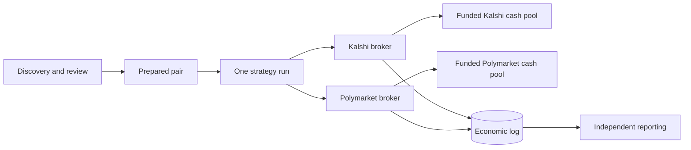

# Cross-market Polymarket experiments

Each run trades one prepared market pair. Its portfolio selects two funded cash
pools, one per venue. The strategy prices the pair, sizes a complete set and
submits every entry and repair through the broker for that venue's pool.
Multiple independent experiments use distinct pools and run as separate processes.

A complete set has an estimated $1 payout only when the venues resolve equivalent
outcomes. Review deadlines, ties, postponements and settlement rules before
selecting the pair. Matching names alone does not establish equivalent payouts.

## Separation of responsibilities

[Pair preprocessing](../../scripts/cross-market-pairs/) discovers markets, matches
teams or questions, applies aliases and reviewed overrides, and exports outcome
mappings. It does not open cash pools or execute orders. The runtime does not
import these tools, enumerate markets or refresh its selection. It reads metadata
and prices only for the pair in its configuration.

Cash pools persist independently of runs. Brokers enforce venue, mode, ownership,
market scope, reservations and available cash. Startup never creates or funds a
pool. A new experiment ID does not reset cash, losses or positions. The optional
`czquant portfolio` command creates a reporting group; that group is not used by
the strategy and has no additional buying power.



The [design principles](../../docs/design-principles.md) define the broker contract.
The [Kalshi](../../docs/services/kalshi-broker.md) and
[Polymarket](../../docs/services/polymarket-broker.md) service guides cover account
mapping, execution capabilities and explicit capital operations.

## Prepare configuration

The runtime interface is `uv run python trader.py --experiment FILE.json`, with
optional --once. The file specifies an ID, portfolio, mode, one pair and parameters.
There are no environment pool selectors, discovery flags or parameter overrides.
Secrets come from exported environment variables; no dotenv file is loaded.

From the repository root, prepare sports candidates using public endpoints:

```bash
export STRATEGY_RUNS_DIR=/absolute/path/to/czquant-runs
mkdir -p "$STRATEGY_RUNS_DIR/experiments"
uv run --project strategies/cross-market-polymarket python scripts/cross-market-pairs/prepare.py \
  --venue polymarket-us --leagues nba --out "$STRATEGY_RUNS_DIR/experiments/candidates.json"
```

Review the candidates and both venues' rules. Copy
[game-a.example.json](experiments/game-a.example.json) to your private experiment
directory. Replace its entire pair object with one reviewed object from the
candidate file's pairs array. The example identifiers and resolution date are
placeholders, not current listings. [game-b.example.json](experiments/game-b.example.json)
uses different pool IDs for a second experiment.

The portfolio maps venue names to pre-created cash pool IDs:

```json
{
  "id": "game-a",
  "portfolio": {"kalshi": "game-a-kalshi", "polymarket_us": "game-a-us"},
  "mode": "paper"
}
```

The pair object has venue, kalshi_event, kalshi_series, polymarket_event,
polymarket_market, resolves_at, outcomes and optional evidence. Preprocessing
resolves aliases and question inversion into the two explicit outcome mappings.
For US markets, the mappings use YES and NO on one PMUS: market slug. For
international markets, they use two PM: token IDs with side YES; only paper
execution is supported. resolves_at is a timezone-aware estimate used for the
return hurdle. evidence retains the matching method and reviewed rules.

Parameters omitted from the file use [Config defaults](trader.py):

- interval_seconds, cooldown and duration_minutes control timing. A null duration
  runs until stopped.
- max_capital_frac limits outstanding cost relative to contributed capital.
  max_sets limits basket size. max_basket_dollars and max_total_dollars impose
  absolute limits; null disables the respective dollar cap.
- risk_free, min_net, min_edge and max_apr control the return hurdle.
  min_edge defaults to $0.01 net profit per matched pair after fees. min_net
  defaults to zero, so there is no separate basket-profit floor unless specified.
- require_cross defaults to true. False permits both outcomes at one venue.
  Opposite sides of the same market are refused because their fills would net.
- kalshi_latency and polymarket_latency specify paper execution delays.
  Repairs sell at visible bids, with no entry-price loss limit.
- pmus_theta overrides US pricing and paper fees. Null uses the market coefficient;
  this parameter does not change live venue fees.
- dry_run requires live mode and builds orders without submitting them.
  monitor_max_age limits the age of live monitor evidence.

Both brokers record the full resolved configuration and code revision at run
start. Each order includes the experiment ID, selected pair and shared trade ID.
Reporting reads the economic log without importing the strategy.

The optional [live launcher](../../scripts/cross-market-launch/) funds missing
pools once, can retire flat previous pools, and supervises the trader and both
account monitors. It preserves balances and history on restart.

## Fund once and run

From this strategy directory, create the two paper pools after preparing the
experiment file. Funding is an explicit operation outside the strategy:

```bash
uv sync --locked
uv run czquant pool game-a-kalshi --venue kalshi --cash 60
uv run czquant pool game-a-us --venue polymarket-us --cash 40
uv run python trader.py --experiment "$STRATEGY_RUNS_DIR/experiments/game-a.json" --once
```

Repeat only the run command on restart. Cash, positions, losses and reservations
remain in the same pools. The pools can be used by a later run; unresolved orders
or incompatible holdings must be reconciled first. Each run considers one pair.

For a second reviewed pair, prepare game-b.json and fund its separate pools once:

```bash
uv run czquant pool game-b-kalshi --venue kalshi --cash 60
uv run czquant pool game-b-us --venue polymarket-us --cash 40
```

Run the two experiments in parallel from the same shell:

```bash
uv run python trader.py --experiment "$STRATEGY_RUNS_DIR/experiments/game-a.json" &
uv run python trader.py --experiment "$STRATEGY_RUNS_DIR/experiments/game-b.json" &
wait
```

Each experiment spends only its pools' cash. Use one process per experiment and
distinct pool IDs for independent runs. Both processes use the same economic log;
their diagnostic directories and KILL files are separated by pool IDs.

## Live preparation and recovery

Live execution requires Polymarket US and pre-created live allocations. Follow
the [virtual-subaccount guide](../../docs/services/virtual-subaccounts.md):
register each venue account with czquant account, then use czquant open-sub to
allocate two dedicated pools per experiment. Optional --markets scopes are
enforced by the brokers. Several US pools require account-wide reconciliation;
repeating map-live cannot prepare these allocations. Registered accounts also
prevent experiments from opening opposite sides of the same market.
Set mode to live, select the live pool IDs and set parameters.dry_run to true
for a dry run. Export the credentials listed in .env.example. The runtime does
not create accounts, move funds or manage allocation ownership.

Run the independent market and account collectors documented in the service
guides against the same logging root. Live runs wait for fresh account and
Polymarket US monitor evidence. Dry runs skip monitor freshness checks while
retaining allocation and unresolved-order checks.

Basket sizing uses the available cash in each selected portfolio's broker pool,
including existing reservations. Candidate sizes must cover both the broker's
fee allowance and the quoted fees at each leg's limit price. The search reduces
quantity to fit each venue before choosing a profitable basket; it cannot use
another game's allocation or the account reserve. Aggregate capital and profit
thresholds still apply.

Before submitting either leg, the strategy reprices the selected pair and calls
Broker.check for both intended orders. It also checks aggregate basket cost and
existing holdings. Broker.submit repeats its checks and reserves funds atomically
for each order. Separate venue orders are not atomic; a preflight result does
not reserve cash or guarantee a fill. Insufficient funding, opposite inventory
or a reconciliation pause records a rejection and leaves the process running.
Invalid pool, scope or pair configuration raises an error before submission.

The thinnest leg goes first as an IOC. Later legs use the smallest known fill.
Known partial fills or failures trigger reduce-only repair of excess holdings.
Unknown results stop further submissions and retain reservations for reconciliation.
Execution failures leave a recoverable entry halt and keep the recovery loop alive.
After all outstanding orders reconcile and both account monitors are healthy,
the strategy compares the two outcomes' total quantities across this experiment's
pools. It retains matched pairs and sells only excess contracts. This comparison
uses actual holdings, so FIFO lot attribution cannot cause duplicate repairs.

Each repair reads fresh bids and sends a reduce-only IOC with a limit at the worst
visible bid needed for the offered quantity. It can realize a loss greater than
5 cents per contract. No bids or a closed market leave recovery pending. Partial
exits retry on later scans with a fresh book and the reconciled remainder. A lost
repair acknowledgement blocks further submissions until the monitor resolves it;
restarting does not duplicate an uncertain sell. At most one recovery order is
submitted per scan. Matched inventory partway through settlement is retained.

Restart reads the existing economic records and cooldown. It does not retry
uncertain orders with new IDs. Acknowledged orders pause entries without a
persistent halt until the monitor books their fills and releases reservations.
Pending or unknown writes still halt entries. Execution-recovery halts clear
automatically only after reconciliation leaves no excess holdings. Settlement
losses, missing provenance, monitor discrepancies, manual halts and KILL files
remain hard stops, including for recovery. Inspect and resolve those conditions
before explicitly clearing their halt:

```bash
uv run czquant halts game-a-kalshi
uv run czquant clear-halt game-a-kalshi --halt-id HALT_RECORD_ID --reason "Reviewed reconciliation and remaining exposure"
```

Clearing a halt does not erase orders or inventory; unresolved conditions halt
again. Keep the ledger and pool identities during recovery. The independent
[reporting service](../../docs/services/reporting.md) provides performance views,
export and backup.

## Validation

Offline tests use fake venues, including fake live adapters:

```bash
uv run pytest -q
uv run basedpyright
```

These checks cover preprocessing exports, one-pair runtime isolation, independent
cash pools, whole-basket preflight, retained balances and reservations, restarts,
partial-fill repairs and unknown execution outcomes. Type checking includes the
preprocessing bundle.

### Profit-bounded slippage

Set `parameters.profit_slippage` to `true` for a Kalshi/Polymarket US
experiment to let IOC orders cross beyond the observed book prices. The default
is `false`. The strategy splits the remaining after-fee profit allowance equally
between the legs, then reallocates unused allowance in submission order when
price increments or pool caps leave room. It preserves `min_edge` at the limit
prices and respects
broker reservations and the basket capital cap. Limits use the market price
increment (a conservative one-cent increment for Kalshi).

After the first fill, recorded execution prices and fees determine the second
limit. The calculation uses the worst actual first-leg price, proportionally
allocates its recorded fees to matched contracts, and bounds second-leg fees for
each possible integer partial fill. Missing fill evidence halts execution for
reconciliation. If no second limit meets the floor, the existing automatic repair
sells the unmatched first leg. Repair losses and a tied game are outside the
completed-basket profit floor. Slippage does not guarantee execution.

`slippage_reprice` observations record the second limit, first-leg price bound,
fees, and matched target quantity. The original expected profit remains the
book-price estimate; order requests record the actual submitted limits.

Price rechecks and preflight rejections before submission do not start a
cooldown; the next scan may evaluate a new candidate.

A confirmed zero-fill canceled/expired IOC uses a one-second cooldown before
another freshly priced attempt. Rejections, transport errors, uncertain orders,
and attempts with fills retain the configured cooldown and recovery rules.

### Streaming execution quotes

Set parameters.execution_websocket to true to use authenticated Kalshi and
Polymarket US order books for entry pricing, rechecks, and repair bids. Both
venue credentials are required. REST remains the source of market metadata and
fee schedules. Streaming execution never falls back to REST books. Paper and
explicitly non-streaming runs retain REST readers.

Kalshi starts with full snapshots for both selected tickers and applies deltas
in subscription sequence order. A missing or repeated sequence number, invalid
delta, subscription error, or disconnect invalidates both books. Reconnection
signs a new handshake and requires both snapshots before execution resumes.
The stream uses immediate updates, without conflation. See Kalshi's
[order-book protocol](https://docs.kalshi.com/websockets/orderbook-updates).

Kalshi book age and connection health are separate. A quiet book remains usable
while sequence continuity holds and client-initiated ping/pong checks succeed.
quote_max_age (default 2 seconds) bounds time since a confirmed pong and the
transmission age of timestamped incoming messages. Pings run at half that
interval; an unanswered ping reconnects after half that interval. A missing
server timestamp is retained as unknown, never invented. Snapshot and delta
receipt ages remain in the log even when a quiet book is valid. Kalshi documents
client pings in its [keep-alive protocol](https://docs.kalshi.com/websockets/connection-keep-alive).

Polymarket US sends full snapshots without debouncing. Its existing conservative
policy requires exchange and receipt ages within quote_max_age; duplicate or
older snapshots do not renew freshness. This differs from Kalshi's sequenced
incremental feed. Both connections clear cached books on disconnect.

Both feeds are checked immediately before each basket submission. If a feed
fails after the first fill, reconciliation and recovery retain unmatched
inventory until usable repair bids are available. execution_quote observations
record each venue's source and freshness evidence before submission. Kalshi
records subscription ID, sequence, connection age, and last book receipt age.

Every scan records its input books, source timestamps, fee parameters, four raw
buy prices, and both fee-adjusted cross-venue gaps in the scan_complete quote
payload. Gaps use the execution pricer and broker funding checks across integer
sizes up to max_sets; max_gap selects profit per pair, best selects total profit.
Positive gaps do not bypass the configured execution thresholds. Missing, stale,
or closed quotes record an empty gap sample and a reason. These observations
are read-only reporting inputs for an independent dashboard, not fills.

The experiment companion reads these scan captures and the existing broker and
account-monitor records. It makes no exchange connections and does not recompute
gaps from reference marks. Generic market collectors remain independent sources
for valuation and settlement; their marks are not substituted for decision data.
