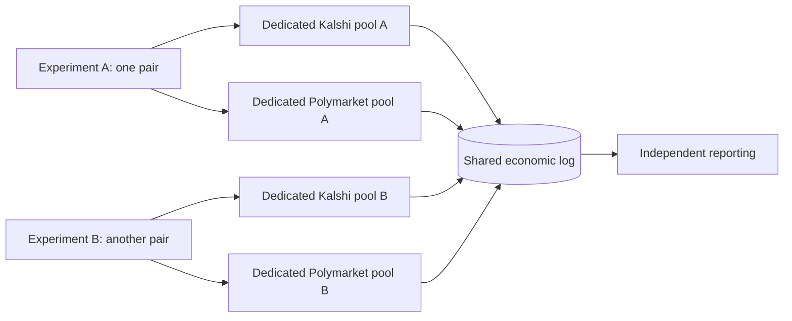

# Cross-market Polymarket experiments

Each experiment trades exactly one reviewed market pair with two dedicated
venue allocations. One Kalshi pool pays only for its Kalshi orders. One
Polymarket pool pays only for its Polymarket orders. These allocations form the
experiment's portfolio; an optional reporting portfolio groups them without
owning cash or making cash interchangeable.

The strategy compares equivalent outcomes and buys a complete set when the
estimated payout exceeds cost and fees. Differences in deadlines, ties,
postponements, or settlement rules can turn an apparent edge into a loss.
Review both markets' rules before selecting their outcome mapping.

## Architecture

The strategy owns configuration, selection, matching, pricing, sizing, execution
sequencing and repairs. Every entry and repair uses a broker bound to one venue
and one pre-created pool. Startup never creates or funds an allocation. Returns,
losses, holdings and reservations remain with those pools across runs. Returning
funds and closing allocations are explicit operator actions outside this strategy.



The [design principles](../../docs/design-principles.md) define the contract.
The [Kalshi](../../docs/services/kalshi-broker.md) and
[Polymarket](../../docs/services/polymarket-broker.md) guides describe account
mapping, venue capabilities, evidence collection and explicit capital operations.

## Experiment configuration

Run from this strategy directory. The interface is
`uv run python trader.py --experiment FILE.json`, with optional --once.
The JSON file contains the experiment ID, both pool IDs, venue, mode, exactly
one pair and its parameters. There are no environment pool selectors or CLI
parameter overrides. Secrets come only from exported environment variables;
the program does not load dotenv files.

Copy [game-a.example.json](experiments/game-a.example.json) to a private working
file outside the checkout. Replace every REPLACE value and TEAM suffix with
actual venue identifiers after reviewing the pair. These templates deliberately
contain no purported current listing. The event slug and market slug are
separate fields; do not substitute team labels for execution identifiers.

For a sports game:

- league is a leagues.json key. Only its selected Kalshi event and Polymarket
  event can produce candidates, even if another discovered game has a better score.
- kalshi_event is the exact event ticker. Each outcome names a different
  Kalshi team market and its YES contract.
- On Polymarket US, venue is polymarket_us. polymarket_market is the actual
  moneyline market slug. Both outcomes name PMUS: followed by that slug, with
  YES and NO mapped to the corresponding Kalshi teams.
- On international Polymarket, venue is polymarket and mode must be paper.
  polymarket_market is the market ID. Each outcome names its own PM: token ID
  with polymarket_side YES.
- The mapping must agree with the venues' team/date matching and league aliases.
  Existing pins cannot add games or override the experiment's outcome mapping.
  Existing blocked events remain excluded.

For a reviewed international binary question, use league markets and set
polymarket_event to its market slug. Both outcomes name the same Kalshi market
with opposite kalshi_side values. Each names the corresponding international
YES token. Set invert true only if Polymarket Yes answers Kalshi No. The selected
pair is resolved directly; changes to markets.json cannot add other questions.

The parameters object accepts these strategy-local fields. Missing values use
Config defaults and all resolved values are logged:

- interval_seconds, discover_minutes, cooldown and duration_minutes control timing.
  duration_minutes null runs until stopped.
- max_event_frac and max_total_frac limit exposure relative to contributed capital.
  max_open_events and max_sets limit positions and basket size.
- max_basket_dollars defaults to 25 and max_total_dollars to 100 in both modes.
  A null dollar cap disables that cap. Both allocations must still fund their own legs.
- risk_free, min_net, min_edge and max_apr control the return hurdle.
  max_apr null disables the upper APR filter.
- require_cross defaults to true. False permits both outcomes at one venue,
  while retaining the same selected pair and pool ownership.
- resolution_hours estimates time to payout. unwind_slippage limits repair prices.
- kalshi_latency and polymarket_latency identify paper execution assumptions.
- pmus_theta overrides US pricing and paper fees; null uses the market coefficient.
  It does not change live venue fees.
- dry_run requires mode live. It builds orders without sending them.
  monitor_max_age limits the age of live monitor evidence.

Both brokers record the full resolved configuration, both sides of the pair,
outcome mapping, experiment ID and Git revision through Broker.start. Orders
carry the experiment ID and a shared trade ID. Reporting reads this common log
without importing or running strategy code.

## Prepare and launch one paper experiment

Set an absolute persistent logging directory outside worktrees. Copy and edit
the example before the launch command below. Keep the private experiment files
beside that persistent store so restart uses the same identities.

```bash
uv sync --locked
export STRATEGY_RUNS_DIR=/absolute/path/to/czquant-runs
mkdir -p "$STRATEGY_RUNS_DIR/experiments"
cp experiments/game-a.example.json "$STRATEGY_RUNS_DIR/experiments/game-a.json"
```

Edit game-a.json with the reviewed identifiers. Create its two paper allocations
once, with explicit cash, then optionally group them for reporting:

```bash
uv run czquant pool game-a-kalshi --venue kalshi --cash 60
uv run czquant pool game-a-us --venue polymarket-us --cash 40
uv run czquant portfolio game-a --pools game-a-kalshi game-a-us
```

Launch one scan. A valid but unavailable or unprofitable pair submits no orders.

```bash
uv run python trader.py --experiment "$STRATEGY_RUNS_DIR/experiments/game-a.json" --once
```

Repeat only the launch command on restart. Do not recreate the pools, replace
the log, change the experiment's pair, or assign its pools to another experiment.
Risk parameters can change between runs; each run records their resolved values.
An incompatible old pool requires reconciliation, not a new ID that hides its losses.

## Run two independent experiments

Copy and edit the second example for a different reviewed pair. It uses a new
experiment ID and two distinct pool IDs while retaining the same logging root.

```bash
cp experiments/game-b.example.json "$STRATEGY_RUNS_DIR/experiments/game-b.json"
uv run czquant pool game-b-kalshi --venue kalshi --cash 60
uv run czquant pool game-b-us --venue polymarket-us --cash 40
uv run czquant portfolio game-b --pools game-b-kalshi game-b-us
```

After editing both files, run each command in its own terminal with the same
exported STRATEGY_RUNS_DIR. Run only one process for each experiment.

```bash
uv run python trader.py --experiment "$STRATEGY_RUNS_DIR/experiments/game-a.json"
```

```bash
uv run python trader.py --experiment "$STRATEGY_RUNS_DIR/experiments/game-b.json"
```

A's spending, profit, losses and reservations do not change B's available cash.
The shared SQLite log holds both experiments. Their diagnostic paths include
both pool IDs, so their logs and KILL files remain separate.

## Live preparation and current limits

Live experiments require Polymarket US and two pre-created live allocations.
Follow the [live mapping guide](../../docs/services/polymarket-broker.md#us-live-mapping-and-execution).
Set the file's mode to live, use those live pool IDs and set parameters.dry_run
true for a dry run. Export KALSHI_API_KEY_ID, KALSHI_PRIVATE_KEY_PATH,
POLYMARKET_US_KEY_ID and POLYMARKET_US_SECRET_KEY_PATH as documented in
.env.example. Use the same --experiment command in paper, dry-run and live modes.

The main-branch US account collector currently supports one active live pool.
Several live experiments sharing that account require the separate
[virtual-subaccount work](https://github.com/Zack-Ellington/cz-quant/pull/31)
and its account reconciliation support. Creating extra paper pools or reporting
portfolios does not solve that live-account requirement. This strategy does not
create subaccounts, transfer funds, or bypass allocation checks.

Run independent collectors against the same logging root. Paper runs use public
references and outcomes; live runs also require account execution evidence:

```bash
uv run czquant monitor market
```

```bash
uv run czquant monitor polymarket-us
```

```bash
uv run czquant monitor account
```

Use monitor polymarket for international paper tokens. Live runs pause when
required monitor evidence is missing or stale. Dry runs skip freshness checks,
but still enforce allocation ownership and unresolved-order checks.

## Validation and recovery

Before either leg, the engine checks the pair mapping, pool existence, venue,
mode, retirement/reserve status, optional exact/prefix market scopes, existing
holdings and orders, and both allocations' ability to fund the full repriced
basket at its limits. A mismatch on the second venue produces zero submissions.
The broker still owns final reservations and accounting. Separate venue orders
are not atomic; prices, available cash and execution can change after validation.

The thinnest leg goes first as an IOC. Later legs use the smallest known fill.
A known later failure triggers reduce-only repair of the known excess holdings.
An unknown outcome stops all further entry and repair submissions. Incomplete
or failed repair leaves holdings intact and records a persistent halt.

Restart reloads cash, positions, reservations, pending/unknown/acknowledged orders,
standing halts and the last order's cooldown. It never retries uncertain orders
with new IDs. Keep the same file and pools while reconciling. Acknowledged live
orders can still require the account monitor to book fills and release reserves.
Incomplete inventory also halts until reviewed, except when an already executed
basket is partway through settlement.

A complete basket's settlement loss, a monitor discrepancy, or a KILL file under
STRATEGY_RUNS_DIR/diagnostics/cross-market-polymarket/<kalshi-pool>/<polymarket-pool>/
also halts. Inspect the experiment's existing orders and holdings, reconcile
against venue evidence, and resolve remaining exposure before clearing a halt:

```bash
uv run czquant halts game-a-kalshi
uv run czquant clear-halt game-a-kalshi --halt-id HALT_RECORD_ID --reason "Reviewed reconciliation and remaining exposure"
```

Clearing a halt does not erase orders or inventory. An unresolved condition
halts again. Do not delete the ledger or create replacement allocations as recovery.
The shared [reporting service](../../docs/services/reporting.md) provides pool and
portfolio views, export and backup. It remains independent of this strategy.

Run offline checks with fake venues, including fake live adapters:

```bash
uv run pytest -q
uv run basedpyright
```

The regressions cover separate experiments in one log, unrelated higher-scoring
games, invalid scopes on either venue, full-basket funding checks, retained
profit/loss/reservations, restarts, known failures and uncertain executions.

## Research tools

find_pairs.py proposes international question matches. Review wording, dates,
sources, cancellation and tie rules before copying one pair into an experiment.
Its candidate files are research inputs and do not expand an experiment's universe.

```bash
uv run python find_pairs.py --source scan
```

ODDPOOL_API_KEY enables the default Oddpool search. These tools and matching.py,
markets.py and sum_check.py remain local to this strategy.
