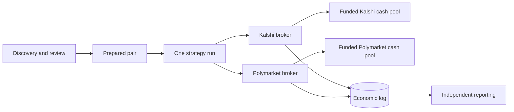

# Cross-market Polymarket experiments

Each run trades one prepared market pair. Its portfolio selects two funded cash
pools, one per venue. The strategy prices the pair, sizes a complete set and
submits every entry and repair through the broker for that venue's pool.
Multiple independent experiments use distinct pools and run as separate processes.

A complete set has an estimated $1 payout only when the venues resolve equivalent
outcomes. Review deadlines, ties, postponements and settlement rules before
selecting the pair. Matching names alone does not establish equivalent payouts.

## Separation of responsibilities

[Pair preprocessing](../../scripts/cross-market-pairs/) discovers markets, matches
teams or questions, applies aliases and reviewed overrides, and exports outcome
mappings. It does not open cash pools or execute orders. The runtime does not
import these tools, enumerate markets or refresh its selection. It reads metadata
and prices only for the pair in its configuration.

Cash pools persist independently of runs. Brokers enforce venue, mode, ownership,
market scope, reservations and available cash. Startup never creates or funds a
pool. A new experiment ID does not reset cash, losses or positions. The
czquant portfolios create command creates a reporting group and can explicitly
fund new paper pools. The strategy resolves that group by ID to its two venue
pools. The group has no additional buying power.



The [design principles](../../docs/design-principles.md) define the broker contract.
The [Kalshi](../../docs/services/kalshi-broker.md) and
[Polymarket](../../docs/services/polymarket-broker.md) service guides cover account
mapping, execution capabilities and explicit capital operations.

## Prepare configuration

The runtime interface is `uv run python runner.py --config FILE.yaml` from this
strategy directory. The file specifies an ID, an existing portfolio ID, mode,
one prepared pair, once and parameters. JSON is also accepted. All run options
can live in the file. Secrets come from exported environment variables; no
dotenv file is loaded. The root [quickstart](../../README.md#run-a-cross-market-paper-experiment)
walks through the complete paper workflow.

Copy [config.example.yaml](experiments/config.example.yaml) to your private
experiment directory. Its pair_file points to a saved discovery candidate file,
relative to the config. pair_index explicitly selects one element of its pairs
array, starting at zero. Review that pair and the venue rules before running;
the runner never discovers or changes pairs. Do not overwrite the candidate
file for an experiment you intend to reproduce.

```yaml
id: game-a
portfolio: game-a
mode: paper
pair_file: candidates.json
pair_index: 0
once: true
parameters:
  max_sets: 20
  max_basket_dollars: 25
  duration_minutes: null
```

The portfolio must already exist, contain exactly one active pool at each
selected venue, and match the configured mode. A missing or invalid portfolio
fails before the engine starts. For an independent experiment, create another
portfolio with distinct pools; changing only the experiment ID does not isolate
capital. The resolved pool IDs and full selected pair are recorded with each run.

An inline pair object can replace pair_file and pair_index. The complete
[game-a JSON example](experiments/game-a.example.json) shows that shape, including
the alternative portfolio mapping from venue names to existing pool IDs.
The trader.py --experiment FILE.json entry point remains available to existing
callers. Both entry points run the same engine; --once requests a single scan.
For YAML inline pairs, quote resolves_at so it remains a string.

The pair object has venue, kalshi_event, kalshi_series, polymarket_event,
polymarket_market, resolves_at, outcomes and optional evidence. Preprocessing
resolves aliases and question inversion into the two explicit outcome mappings.
For US markets, the mappings use YES and NO on one PMUS: market slug. For
international markets, they use two PM: token IDs with side YES; only paper
execution is supported. resolves_at is a timezone-aware estimate used for the
return hurdle. evidence retains the matching method and reviewed rules.

Parameters omitted from the file use [Config defaults](trader.py):

- interval_seconds, cooldown and duration_minutes control timing. A null duration
  runs until stopped.
- max_capital_frac limits outstanding cost relative to contributed capital.
  max_sets limits basket size. max_basket_dollars and max_total_dollars impose
  absolute limits; null disables the respective dollar cap.
- risk_free, min_net, min_edge and max_apr control the return hurdle.
  min_edge defaults to $0.01 net profit per matched pair after fees. min_net
  defaults to zero, so there is no separate basket-profit floor unless specified.
- require_cross defaults to true. False permits both outcomes at one venue.
  Opposite sides of the same market are refused because their fills would net.
- kalshi_latency and polymarket_latency specify paper execution delays.
  Repairs sell at visible bids, with no entry-price loss limit.
- pmus_theta overrides US pricing and paper fees. Null uses the market coefficient;
  this parameter does not change live venue fees.
- dry_run requires live mode and builds orders without submitting them.
  monitor_max_age limits the age of live monitor evidence.

Both brokers record the full resolved configuration and code revision at run
start. Each order includes the experiment ID, selected pair and shared trade ID.
Reporting reads the economic log without importing the strategy.

## Create a portfolio and run

The [operator CLI guide](../../docs/cli.md) documents portfolio commands and
retirement after positions and orders are cleared.

Copy [portfolio.example.yaml](experiments/portfolio.example.yaml), edit its IDs
and funding, and create it once through the operator CLI. From this directory:

```bash
uv sync --locked
uv run czquant portfolios create --config "$STRATEGY_RUNS_DIR/experiments/portfolio.yaml"
uv run czquant portfolios list
uv run python runner.py --config "$STRATEGY_RUNS_DIR/experiments/config.yaml"
uv run czquant portfolios inspect game-a --events 20
```

Repeat only the runner command on restart. Cash, positions, losses and
reservations remain in the same pools. The pools can be used by a later run;
unresolved orders or incompatible holdings must be reconciled first. Each run
considers one pair. Use one process per experiment. Run additional processes
with separate configs and distinct portfolios for independent experiments.

The strategy owns execution only. Create, allocate, inspect and report using
czquant commands in separate steps. For longer runs, set once to false; a null
parameters.duration_minutes runs until Ctrl-C. Stopping does not close positions.

## Live preparation and recovery

Live execution requires Polymarket US and pre-created live allocations. Follow
the [virtual-subaccount guide](../../docs/services/virtual-subaccounts.md):
register each venue account with czquant account, then specify account and cash
for each pool in a [live portfolio config](experiments/portfolio-live.example.yaml).
czquant portfolios create --config FILE.yaml allocates from both reserves and
creates the portfolio atomically. Select its ID in the runner config. Optional
markets lists in the portfolio config restrict each allocation; these scopes are
enforced by the brokers. Several US pools require account-wide reconciliation;
repeating map-live cannot prepare these allocations. Registered accounts also
prevent experiments from opening opposite sides of the same market.
Set mode to live, select the live pool IDs and set parameters.dry_run to true
for a dry run. Export the credentials listed in .env.example. The runtime does
not create accounts, move funds or manage allocation ownership.

Run the independent market and account collectors documented in the service
guides against the same logging root. Live runs wait for fresh account and
Polymarket US monitor evidence. Dry runs skip monitor freshness checks while
retaining allocation and unresolved-order checks.

Basket sizing uses the available cash in each selected portfolio's broker pool,
including existing reservations. Candidate sizes must cover both the broker's
fee allowance and the quoted fees at each leg's limit price. The search reduces
quantity to fit each venue before choosing a profitable basket; it cannot use
another game's allocation or the account reserve. Aggregate capital and profit
thresholds still apply.

Before submitting either leg, the strategy reprices the selected pair and calls
Broker.check for both intended orders. It also checks aggregate basket cost and
existing holdings. Broker.submit repeats its checks and reserves funds atomically
for each order. Separate venue orders are not atomic; a preflight result does
not reserve cash or guarantee a fill. Insufficient funding, opposite inventory
or a reconciliation pause records a rejection and leaves the process running.
Invalid pool, scope or pair configuration raises an error before submission.

The thinnest leg goes first as an IOC. Later legs use the smallest known fill.
Known partial fills or failures trigger reduce-only repair of excess holdings.
Unknown results stop further submissions and retain reservations for reconciliation.
Execution failures leave a recoverable entry halt and keep the recovery loop alive.
After all outstanding orders reconcile and both account monitors are healthy,
the strategy compares the two outcomes' total quantities across this experiment's
pools. It retains matched pairs and sells only excess contracts. This comparison
uses actual holdings, so FIFO lot attribution cannot cause duplicate repairs.

Each repair reads fresh bids and sends a reduce-only IOC with a limit at the worst
visible bid needed for the offered quantity. It can realize a loss greater than
5 cents per contract. No bids or a closed market leave recovery pending. Partial
exits retry on later scans with a fresh book and the reconciled remainder. A lost
repair acknowledgement blocks further submissions until the monitor resolves it;
restarting does not duplicate an uncertain sell. At most one recovery order is
submitted per scan. Matched inventory partway through settlement is retained.

Restart reads the existing economic records and cooldown. It does not retry
uncertain orders with new IDs. Acknowledged orders pause entries without a
persistent halt until the monitor books their fills and releases reservations.
Pending or unknown writes still halt entries. Execution-recovery halts clear
automatically only after reconciliation leaves no excess holdings. Settlement
losses, missing provenance, monitor discrepancies, manual halts and KILL files
remain hard stops, including for recovery. Inspect and resolve those conditions
before explicitly clearing their halt:

```bash
uv run czquant halts game-a-kalshi
uv run czquant clear-halt game-a-kalshi --halt-id HALT_RECORD_ID --reason "Reviewed reconciliation and remaining exposure"
```

Clearing a halt does not erase orders or inventory; unresolved conditions halt
again. Keep the ledger and pool identities during recovery. The independent
[reporting service](../../docs/services/reporting.md) provides performance views,
export and backup.

## Validation

Offline tests use fake venues, including fake live adapters:

```bash
uv run pytest -q
uv run basedpyright
```

These checks cover preprocessing exports, one-pair runtime isolation, independent
cash pools, whole-basket preflight, retained balances and reservations, restarts,
partial-fill repairs and unknown execution outcomes. Type checking includes the
preprocessing bundle.
