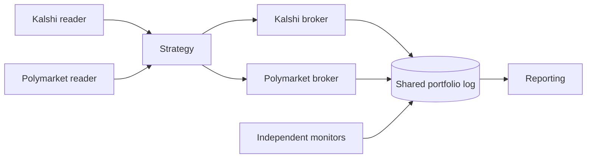

# Cross-market Polymarket strategy

This strategy compares equivalent outcomes on Kalshi and Polymarket, then buys
a complete set when the estimated payout exceeds cost and fees. It uses
Polymarket US by default, on paper or live. International Polymarket is available
for paper experiments with --venue polymarket.

A complete set pays as expected only if both venues resolve the question the
same way. Differences in deadlines, ties, postponements, or settlement rules
can turn an apparent edge into a loss. Pairing evidence is recorded with every
order; partial execution leaves directional exposure.

## Architecture

The strategy owns discovery, matching, pricing, sizing, sequencing, and risk
policy. It reads venue data directly and imports no other strategy. Every
entry, exit, and unwind goes through one of two venue-bound brokers.



The brokers share a portfolio and run ID. Order context links legs by trade_id;
it does not make execution atomic. Paper mode shares one hypothetical cash
pool. Live mode tracks each venue's cash and reservations separately. Restarts
retain positions, losses, and standing halts in STRATEGY_RUNS_DIR.

- matching.py pairs sports events by teams, date, and start time. leagues.json
  supplies aliases and rule notes. pairs.us.json and pairs.json contain pins
  and exclusions for the US and international venues respectively.
- markets.py loads non-sports question pairs for international paper runs.
- sum_check.py walks both books, applies fees, and sizes candidates against
  capital limits and the configured return hurdle.
- trader.py coordinates the run. It rechecks a candidate, sends its thinnest
  leg first as an IOC order, and limits later legs to the smallest fill so far.
  Excess contracts are offered back with reduce-only IOC orders within the
  configured slippage. Unknown outcomes halt execution before another leg.

The [design principles](../../docs/design-principles.md) define the contract.
The [Kalshi](../../docs/services/kalshi-broker.md) and
[Polymarket](../../docs/services/polymarket-broker.md) guides describe broker
capabilities, credentials, fee evidence, account allocation, and recovery.

## Paper run

Run from this strategy directory. Set STRATEGY_RUNS_DIR to persistent storage
outside the checkout. Configuration comes from exported environment variables;
.env.example lists them, but the program does not load an environment file.

```bash
uv sync --locked
export CZQUANT_PORTFOLIO=cross-market-polymarket
uv run czquant portfolio "$CZQUANT_PORTFOLIO" --cash 1000
uv run python trader.py --once --leagues nba
```

Create the portfolio once. Both venue brokers use this one portfolio; they
do not each receive $1,000. Paper cash is pooled, while live cash is recorded
separately for each venue. Subsequent runs reuse the portfolio and its history:

```bash
uv run python trader.py --duration 4:00
```

For international paper trading, add --venue polymarket. The US market uses
one PMUS: slug with YES/NO sides. International markets use separate PM:
outcome-token IDs. The broker adapters keep those representations distinct.

Run the reference collectors in separate shells with the same logging root:

```bash
uv run czquant monitor market
uv run czquant monitor polymarket-us
```

Use monitor polymarket instead of polymarket-us for international tokens.
Public outcomes settle paper holdings. The shared dashboard and reports read
the same ledger without importing this strategy.

## Live run

Follow the [live mapping guide](../../docs/services/polymarket-broker.md#us-live-mapping-and-execution)
to create a portfolio with a Kalshi allocation and a Polymarket US account.
Shared Kalshi accounts and explicit ledger allocations are supported.
Live trading is available only with Polymarket US.

Run monitor market for Kalshi price references, monitor account for Kalshi
execution recovery, and monitor polymarket-us for US references and account
reconciliation. Live settlement requires account evidence.

A dry run builds orders and sends none:

```bash
export CZQUANT_PORTFOLIO=cross-market-polymarket-live
uv run python trader.py --live --dry-run --leagues nba --once
```

A live run sends real IOC orders:

```bash
uv run python trader.py --live --leagues nba --max-basket-dollars 25 --max-total-dollars 100
```

Live defaults are $25 per basket, $100 total exposure, and 20 sets per basket.
Each venue must have enough recorded available cash for its leg. Kalshi fills
arrive through account recovery, so reservations count toward exposure until
reconciled. US fills are recorded from synchronous execution reports.

This strategy pauses when either account monitor is missing or older than
five minutes. It halts on an unknown order outcome, a portfolio discrepancy,
a complete basket settling at a loss, or a KILL file under
STRATEGY_RUNS_DIR/diagnostics/<portfolio>/. Halts persist across restarts;
inspect and resolve their evidence before using czquant clear-halt. Partial
basket losses are recorded but do not by themselves trigger the complete-set
loss rule. Dry runs skip monitor freshness checks.

These checks are this strategy's risk policy. They are not broker requirements
for other strategies. Live integration limits are documented in the
[Polymarket guide](../../docs/services/polymarket-broker.md#us-live-mapping-and-execution).

## Experiment settings

Use trader.py --help for all flags. The main controls are:

| Flag | Default | Controls |
| --- | --- | --- |
| --leagues | Enabled leagues | Sports universe |
| --interval | 15 seconds | Scan interval |
| --discover | 10 minutes | Universe refresh |
| --max-event-frac | 0.10 | Capital per event |
| --max-sets | 500 paper, 20 live | Basket size |
| --min-edge | 0.01 | Net edge per set |
| --min-net | 0.25 | Net dollars per basket |
| --risk-free | 0.05 | Annual return hurdle |
| --unwind-slippage | 0.05 | Exit price allowance |
| --cooldown | 300 seconds | Repeat-event delay |
| --any-venue | Off | Allow single-venue sets |
| --no-markets | Off | Skip non-sports pairs |

Pricing uses Kalshi's series fee multiplier and the selected Polymarket
market's fee schedule. --pmus-theta overrides the coefficient used for US
pricing and paper simulation; it does not change live fees.

## Research tools

For international non-sports questions, find_pairs.py proposes matches:

```bash
uv run python find_pairs.py --source scan
```

With ODDPOOL_API_KEY, the default source uses Oddpool series search;
--topics fed,cpi narrows it. Review wording, dates, source, cancellation,
and tie rules before copying a candidate into markets.json. Auto-approval
with --auto-approve writes unreviewed markets.auto.json for paper benchmarking.
Reviewed entries take precedence. These pairs are skipped on Polymarket US.

## Reporting

Use the shared [reporting service](../../docs/services/reporting.md) from
packages/czquant with the same STRATEGY_RUNS_DIR. Its dashboard shows current
portfolio economics and monitor health; frozen reports compare portfolios over
a specified window. Both read the shared ledger without running or importing
this strategy. The strategy records order context and diagnostics for external
analysis and does not host its own reporting view.

## Validation

```bash
uv run pytest -q
uv run basedpyright
```

Fixture tests cover matching, pricing, two-broker execution, partial fills,
unwinds, restart recovery, and live guards without placing real orders.
